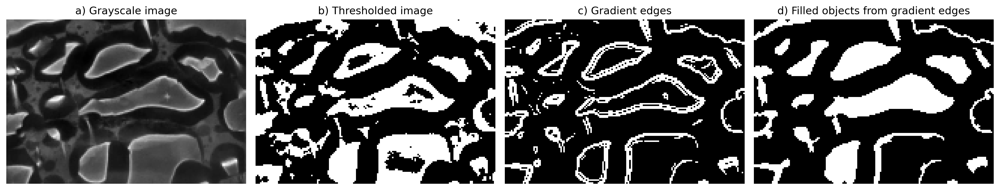

bibliography: tracking.bib

# Simple-Track: A Data-Agnostic Python Object Tracker

## Summary
[Needs more definition of the problem first for GMD. Then, reduce the description of ST below]

[There is a growing desire in geosciences for reliable algorithms that can track the evolution of extended objects across discrete timesteps. Previous studies have detailed the development of separate schemes for tracking,  wildfire fronts, coronal holes, mesoscale convective systems... among others. Most of these trackers are designed in the same way: first, they identify relevant objects in a frame, and then they match those objects between consecutive frames. While there is large diversity of approaches in the methods used to identify objects, matching objects is commonly performed using similar overlap-based criteria. There is therefore a need/gap for a common framework that unifies this common tracking process while being versatile enough to handle a wide variety of inputs and feature identification methods.]

[Simple-Track is a Python-based object tracking algorithm for 2D data, designed to track the complex interactions that can emerge between extended objects. Objects can be defined flexibly by the user, but in their simplest form, represent contiguous data regions matching a threshold condition. Feature matching is aided by the inclusion of a bespoke flow solver, making it specialised in tracking object motions linked to a physical flow. Simple-Track also includes advanced logic for identifying merging and splitting events, and uses this to compile comprehensive feature interaction histories.]
[This section is probably too much. Need to cut down a bit!]
<!-- Objects are tracked between consecutive frames by predicting their location at a common timeframe and matching based on the degree of overlap -->

[The data-agnostic philosophy of Simple-Track is highlighted by the modular workflow design and support for user-configurable data loading routines. The variety in application is demonstrated with three examples across geoscientific fields: tracking convection in high-resolution numerical weather prediciton models, tracking wildfire front locations in IR satellite imagery, and tracking coronal hole locations from EUV images... ]

## State of the Field
Tracking the motion of objects through discrete snapshots has been a longstanding problem, particularly within video and computer-vision research. Here, multi-object trackers (MOTs) track bounding boxes surrounding rigid bodies such as cars, people, or animals, whose motion is primarily self-determined. The largest issue limiting tracking accuracy in MOTs is the estimation of 3D motion using only image-plane projections. Objects that pass in front of other objects can confuse algorithms unless they use occlusion-handling techniques, such as persistence tracking [@bewley_simple_2016], re-identification using previous track properties [@wojke_simple_2017], or separately matching occluded tracks with "blurry" objects that have larger identification uncertainty [@zhang_bytetrack_2022]. Additionally, tracking accuracy can be affected by camera shake or other erratic movements. These undesirable motions can be compensated for by using optical flow schemes, which estimate all-pixel (dense) or sharp-feature (sparse) motion vectors [@le_besnerais_dense_2005 @hamprecht_duality_2007 @kroeger_fast_2016 @ayzel_optical_2019]. Parallax effects are captured by using a hierarchy of tracking resolutions to accurately capture larger-scale foreground motion and smaller-scale background motion. [perhaps getting too into the weeds at the end of this paragraph? Is this information necessary?]

Most MOTs follow a "tracking-by-detection" procedure, which first identifies relevant objects in a frame, and then links these objects between frames to form trajectories [@bewley_simple_2016 @wojke_simple_2017 @zhang_bytetrack_2022]. Bounding boxes surrounding objects of interest can either be identified using single-shot detectors that process an image in a single iteration [@redmon_you_2016], or using slower two-stage detectors that refine the initial estimation [@bewley_simple_2016]. From there, linking objects between frames typically follows the same three-stage process: motion prediction, similarity estimation, and object assignment. Motion prediction is most often performed using a constant-velocity Kalman filter [@bewley_simple_2016, @wojke_simple_2017, @zhang_bytetrack_2022]. Object similarity between the predicted and actual object locations can be assessed by using a simple overlap comparison, potentially with occlusion adjustments. Finally, objects are typically matched using The Hungarian algorithm [@bewley_simple_2016 @wojke_simple_2017 @zhang_bytetrack_2022], an efficient method for assigning two sets of items by minimising an associated cost function (in this case, the overlap between each object in both frames).

MOTs can either be configured for real-time, high-frequency object tracking or for more robust analysis after the event. In research contexts, it is usually more desirable to choose accuracy over efficiency, especially since input data may need pre-processing or interpolation before it is ready for tracking. Additionally, in physical sciences, the definition of an object does not usually have the same level of ambiguity or require the same level of analysis as in MOTs. There are, however, different classes of trackers which treat objects as fundamentally different entities: particle trackers and extended object trackers. Particle trackers assume that each object is composed of a single "bright" pixel, and that other nearby bright points are just an artifact of instrument noise. This approach requires extra processing to find the exact pixel producing the signal. Extraneous information about object shape or area is usually discarded. Extended-object trackers, meanwhile, encompasses object morphology as a core part of the tracking process.

While most particle and extended-object trackers also use the same tracking-by-detection procedure, their methods for identifying objects differ. The Crocker-Grier algorithm is one of the earliest and most popular particle-tracking algorithms, designed to track the motion of colloidal droplets suspended within another liquid [@crocker_methods_1996]. Here, particles are identified as the local maxima in brightness among points in the 70th percentile of brightness across the image. This brightness-weighted approach is also used in more modern tracking packages [@sbalzarini_feature_2005 @allan_trackpy_2025], though others favour a wavelet decomposition or gaussian-fit strategy [@jaqaman_robust_2008]. Linking strategies also differ between particle trackers, with some choosing nearest-neighbours [@allan_trackpy_2025], while others solve a global optimisation problem using a Hungarian algorithm approach [@jaqaman_robust_2008]. The design approach for each of these trackers is largely driven by their domain and purpose. As a result, extensions that handle object merging and splitting have become more popular, particularly with trackers used in molecular biology [@sbalzarini_feature_2005 @jaqaman_robust_2008].

<!-- [Additionally, extended objects can be defined more confidently when [more data...], making simpler methods for linking objects, such as overlaps, more viable (is this true?)]. -->

Compared to particle trackers, there are an even wider variety of uses for extended-object trackers. As such, these trackers can differ substantially in their construction from MOTs and particle trackers. For example, trackers that permit object shape deformations usually also include merging and splitting treatments. In biological imaging, the popular TrackMate and Lineage Mapper tools can track mitosis and cell absorption alongside other morphological properties [@chalfoun_lineage_2016, @ershov_trackmate_2022]. The most recent iteration of TrackMate includes many different object identification algorithms that can all use the same linking and analysis tools. In solar imaging, the CHIMERA and SPoCA tools use multi-thermal imaging to identify and track coronal holes or active regions within different altitudes of the solar atmosphere [@verbeeck_spoca-suite_2014, @garton_automated_2018]. The combination of several reference images strengthens identification certainty and allows on-disc features to be separated from off-limb features more effectively. In wildfire analysis, a database of recent wildfire events over California has been compiled using the VIIRS satellite to track the propagation of active fire pixels [@chen_california_2022]. This tool uses a balltree algorithm to assign nearest-neighbour active pixels to a particular cluster, and then assigns these clusters to existing fire objects based on a land-type dependent radial neighbourhood. Active-pixel clusters that don't match to an existing fire are initialised as a new object, while clusters that match to multiple fires cause them to merge. Fire objects themselves are classed as "active" if any of their pixels were active over the previous five days.

Oceanography research also makes frequent use of extended-object trackers. Ice Floe Tracker takes daily images from the MODIS satellite and applies an in-depth processing routine using K-means clustering to separate ice floes from the background water, and using a watershed algorithm to separate individual ice floes [@lopez-acosta_ice_2019]. Unlike other trackers, objects in Ice Floe Tracker are matched based on the similarity of geometric properties (area, major/minor axis radii) rather than overlap. Additionally, ocean eddie trackers are used to understand the impact of mesoscale circulation features on local weather patterns and upper-ocean ecology [@vu_angular_2018, @pegliasco_meta31exp_2022]. These trackers define objects as closed contours around sea-surface height or angular momentum extrema, and are linked using overlap methods. These trackers also require explicit handling of merging and splitting events. 

In a broader weather and climate science context, extended-object trackers are incredibly useful for analysing the evolution of convective cells [@dixon_titan_1993, @stein_dymecs_2015, @keat_convective_2019, @lo_use_2024] and mesoscale convective systems [@crook_impact_2024, @maybee_how_2025, @feng_mesoscale_2025] in models and observations. One of the earliest radar analysis tools, TITAN, includes tracking as part of its extensive suite of processing methods [@dixon_titan_1993]. Simple-Track itself was originally designed as a convective cell tracker, and includes the same overlap-based linking method as TITAN. However, a key difference in Simple-Track is the inclusion of a flow-derived feature-projection step to aid with this overlap comparison. TITAN, on the other hand, performs a second centroid-matching step by solving a path optimisation problem constrained using upper bounds on storm size and speed. As well as TITAN and the first iteration of Simple-Track, other dedicated convection trackers have been developed using different philosophies. tobac is built on the trackpy particle tracker and defines an object using multiple, nested thresholds [@heikenfeld_tobac_2019]. Merging and splitting is permitted, and projected storm locations are estimated using trajectory persistence. PyFLEXTRKR is another multi-threshold storm tracker, but also supports tracking using multiple parameters. Feature projection, merging, and splitting are handled in a similar way to Simple-Track. This consistency in design philosophy may explain the similarity in tracking behaviour when Simple-Track and PyFLEXTRKR were compared with other mesoscale convective system trackers [@feng_mesoscale_2025]. Both were evaluated as being average compared to other trackers when comparing their storm size distributions, tracking lifetimes, and contribution of physical quantities within tracked features to the total amount of that quantity.

<!-- todo: mention moaap -->

<!-- TODO: perhaps need even more in depth comparisons with closest trackers, pyflextrakr, tobac and moaap -->

## Statement of Need

Given the wide variety of existing studies that use extended-object tracking as part of their analysis, there is a clear desire for tracking tools across the academic community. Many of these studies produced their own bespoke trackers from scratch that are rigorously tested and validated for their intended purpose. To get to this stage, researchers must spend considerable time designing these trackers, particularly the identification and linking methods. The examples in the previous section show that there are many valid approaches for identifying features, however researchers often arrive at a similar set of processes for linking these features. 

Simple-Track is designed to be an easy-to-use, general-purpose tracker utilising commonly-used feature linking methods. The data-agnostic design makes it easy for researchers to develop their own identification algorithms that feed directly into the core tracking workflow - the only inputs expected by Simple-Track are matched pairs of datetime objects and numpy arrays. While we don't anticipate that Simple-Track will be suitable for every context, the simple interface allows researchers to rapidly test this suitability and build on its established framework where necessary. The flexibility of Simple-Track is facilitated by its object-oriented design, defensive input validation to ensure codebase extensions remain compatible with the rest of the workflow, and extensive testing which includes an easy to run minimal working example. Other user-friendly features include custom data classes, easy control over input and output parameters, and recovery of sequential tracking data from parallel batches.

Simple-Track also has a proven track record of integrity within weather and climate research. Most of the existing studies have used Simple-Track to evaluate the performance of high-resolution numerical weather prediction models across various regions of the Earth [@stein_dymecs_2015, @keat_convective_2019, @lo_use_2024]. Other studies have used Simple-Track to investigate the representation of larger mesoscale convective systems compared to satellite observations [@crook_impact_2024, @maybee_how_2025, @feng_mesoscale_2025]. In all studies, Simple-Track was a core tool that facilitated the production of datasets that provided novel insights into these complex physical structures. 

<!-- The rest of this paper is organised as follows... -->
 
## Software Design

Simple-Track follows the same tracking-by-detection procedure as most other extended-object trackers. The workflow can be broken down into four steps as shown in Figure []: user pre-processing and feature identification, flow estimation, feature projection, and finally feature linking. 

### Step 1: User Pre-Processing and Feature Identification
A large component of Simple-Track's flexibility stems from the approach for handling data pre-processing. To run tracking, the code expects data to be provided as a dictionary of datetime object keys and numpy array values. This data can either be passed to the tracker directly if running Simple-Track within a Python script, or output from a custom loading function referenced in the input config.

The loading function can be as simple as using bespoke libraries to read data into a numpy array. Simple-Track will then identify features in the image according to a basic set of rules: a value threshold, and a minimum size threshold. Any contiguous region of data that meets the value threshold and is above the minimum size will be defined as an object. An example of this type of loading will be used in a later section, where objects are defined as areas above 3 mm/hr of precipitation spanning more than 4 pixels.

The loading function may also contain routines that meaningfully modify the data to make it more suitable for tracking. Primarily, this would involve making extended objects that are easier to define based on a single threshold. For instance, in section [wildfires] exploring a proof-of-concept wildfire tracking scheme, objects that are defined purely on currently-active burning pixels are typically too linear and fragmented to produce coherent structures. Instead, the loading routine developed for this example takes a rolling accumulation of burnt pixels over five days to define a more robust object for tracking [@chen_california_2022].

In some instances, a user may wish to define an object using more complicated criteria than just threshold exceedance. These situations can also be accounted for by including the bespoke identification criteria within the loader, and then passing a binary feature or not-feature array to Simple-Track along with a corresponding threshold between 0 and 1. One example is demonstrated in the code testing, with square binary regions that are propagated, split, and merged over multiple artificial frames as a test of the Simple-Track workflow. A more realistic case is shown in Figure [oil], demonstrating some examples of pre-processing images of oil droplets suspended in water. The droplets are not evenly illuminated which makes an attempt at defining objects based purely on brightness insufficient (Fig oil b). Instead, a gradient-based edge detection scheme (Fig oil c) combined with a binary fill scheme (Fig oil d) produces a smoother field that is more useful for tracking. These pre-processing steps, along with any others that improve object identification, can easily be included in the loading functions. 

Once data is loaded into Simple-Track, each contiguous region met by the threshold is labelled with a unique identifier using a floodfill algorithm. The connectivity structure between neighbouring pixels can be chosen by the user but is set to eight-way connectivity by default (i.e., all cardinal and diagonal pixels surrounding a given pixel are connected by the same label). This procedure is called using `scipy.ndimage.label`. Feature labelling occurs in each input field independently, and it is therefore unlikely that the same feature in different fields will be assigned the same label at this stage. The purpose of the next three steps is therefore to identify matching features between the two frames and enforce label consistency.

### Step 2: Flow Estimation

Once features have been identified, the next step is to estimate the flow field that would, in theory, translate the features from the previous frame to the current frame. One option for evaluating the flow field is to use optical flow schemes, which are commonly used in image processing to align different colour channels or interpolate between video frames [need ref]. Flow fields are estimated by measuring brightness variations of pixels between frames, although assumptions about average brightness and local homogeneity are needed to close the relevant constraint equation. As such, basic optical flow schemes can struggle to accurately estimate motion within scenes containing variable light levels or without clear brightness gradients. Simple-Track includes three optical flow schemes powered by external libraries: a Dense Inverse Search scheme [DIS, @kroeger_dense_2016] from the OpenCV package which was found to perform best within a radar nowcasting study [@ayzel_optical_2019], and the inverse Lucas-Kanade (ILK) and [TVL] schemes included in the scikit-image package. These schemes have been shown to work well at accounting for large gradients in vector magnitude caused by parallax effects, where nearby objects transit the image plane faster than more distant objects. 

[Include and/or make a phase correlation schematic here]

As well as supporting existing optical flow schemes, Simple-Track also includes a bespoke ``pseudo optical flow`` solver which takes a different approach to estimating the flow field. Rather than solving a global or local constraint equation, the bespoke solver partitions the domain into overlapping subdomains and calculates a scalar dx and dy for each subdomain. These displacements are calculated using a standard phase correlation method that is also common in image registration. The above figure shows a schematic for performing this phase correlation. The cross-power spectrum between each object field is first calculated to assess spatial similarity. When this power spectrum is transformed back to real space, the index of maximum power indicates the best integer estimate of the pixel displacement between the two inputs. These integer dx, dy estimates are valid across the subdomain. In Simple-Track, this procedure is called using `skimage.registration.phase_cross_correlation`. Phase correlation is performed individually for all overlapping subdomains and interpolated to the full grid by 2D cubic interpolation using `scipy.interpolate.RectBivariateSpline` with bivariate spline values kx=3, ky=3.  

Before displacements are calculated, input fields are filtered using a tukey window which tapers values towards zero at the edges of each subdomain. A tukey window is a combination of a cosine and Hanning window that provides a good balance between preventing spectral leakage and maintaining good frequency resolution. The filter is calculated using `scipy.signal.windows.tukey` for each dimension separately and combined using an outer product to yield the 2D mask.

Unlike the external optical flow schemes, the built-in flow method is considered a "sparse" solver since it can only estimate the flow over regions containing data: it does not attempt to estimate motion over empty regions. As with most optical flow schemes, this solver includes a parameter to determine the trade-off between better flow resolution and increased smoothness. Larger subdomains include more data, thereby increasing smoothness of the final, stitched-together domain field, but at the expense of lower resolution.

For 2D data where parallax and occlusion considerations are unimportant, the bespoke flow solver is fast and accurate. Figure [] shows the results of a test where each flow scheme is used to estimate the location of cloud features in successive radar scans over a six hour period [fig xa), which should show the schematic for this expt]. For a frame at a given time t and with constant time interval dt between frames, the flow field F is estimated between frames t and t+2dt. Then,  F/2 is used to project features from frame t onto the same time valid time as t+dt. Then, the rmse between the projected feature location and actual feature location is calculated. Features are advected using the same procedure outlined in the next section. For this experiment, a threshold of 3mm/hr is used to define an object, which results in a feature coverage of approximately x% over the 6 hour period. Note also that this test does not check for feature label accuracy, only that a pixel exceeding the threshold is present in both the projected and observed frames. Since there will be inevitable feature evolution between frames even with the short dt used here (dt=5 minutes), there is a lower limit to the accuracy that a simple advection test can produce. Nevertheless, we can still assert that lower error scores indicate that a given flow scheme is more accurate at estimating motion direction and magnitude.

Figure [x b)] shows the results of this projection experiment for a range of parameter sets. The TVL tests use different permutations of attachment (0.5 to 0.9) and tightness (0.3 to 0.9) which control [x] and [y] respectively. ILK, DIS and ST use patch sizes or search radii from 20 to 100 in increments of 10... [Describe the effect of these params in more detail.] [Then, describe the idea that we are also testing against calculating with raw, binary and features.]

[For ST, note increasing accuracy with subdomain size at cost of resolution. If a size is not set by the user, it will default to the domain size rounded to nearest oom divided by 5. For these experiments, a full domain size of 303 x 341 is expanded to 400 x 400, giving a subdomain size of 80x80 (parameter set 6 on the rmse graph).]

<!-- TODO: figure out why some expts are completely insensitive to params (using raw fields and ILK in particular) -->

<!-- An example of the flow field obtained by this process is shown above. Note in particular that it is only possible to estimate the flow over regions where features are present, hence there are sparse regions in the top left and bottom right of the domain. The main parameter for step 2 is the number (or size) of sub-domains. The size of sub-domain should reflect the largest region over which storm displacement can be considered uniform. This will vary with user case. In an effort to simplify the input options, this parameter will default to the domain shape divided by five if not set by the user. This default is a reasonable starting point for many cases but may need to be adjusted by the user if the flow field exhibits large temporal or spatial variability. -->

### Step 3: Feature Projection
[include a schematic here showing the feature projection]

The next step is to use the derived flow field to artificially advect features in the previous frame to estimate their location at the time of the current frame. This pseudo-nowcasting process is an important step for accurately matching features between the two frames in a way which reduces the dependence on the time between frames. While this step could in theory be performed using an image morphing technique, a simpler solution is implemented here. Instead, the feature-average displacement is used to translate each feature in the "feature_field". In the case of multiple features attempting to occupy the same pixel, the id value that is closest to its feature centroid is chosen. Strictly, these features should merge if they come into contact, but this would be undesirable for the purposes of tracking since the merged feature could be removed entirely and then no longer present for matching.

## Step 4: Match Features

[Add feature matching schematic]

With both frames now valid at the same effective timestep, features in the current frame are then matched to features in the ``advected'' frame. A feature is considered matched if the fraction of overlap exceeds a certain threshold. For a given Feature in the current frame, the overlap is calculated by iterating over each feature in the advected frame and calculating the intersection over union normalised to be bounded between 0 and 1 [Double check this is actually what is calculated, I think it is!]. This is the same process used in TITAN, and, accounting for normalisation, the same default threshold of 0.3 is also used here. 

If no features are matched, the comparison is repeated over an expanded circular neighbourhood surrounding the feature in the current frame (see [Handling Insufficient Overlaps](#handling-insufficient-overlaps)). Then, as depicted in Figure above, the following the procedures are performed based on the number of matched features:

* Panel (b): If no matched features are found in the previous frame, the feature in the new frame is considered to be a new feature which is given a new id not used by a feature in any previous frames.

* Panel (c): If a single matched feature is found in the previous frame, the feature in the current frame will inherit its id (and given to the `Feature.provisional_id` property) and will inherit and increment its lifetime.

* Panel (d): If multiple matched features are found:

    * The feature with the closest size is chosen as the matched feature to inherit its properties.
    * If this process finds multiple suitable candidate, the feature with the closest centroid is then chosen as the match.
    * If this still does not choose a single feature, then the feature with the smallest id is chosen.

    All other matched features that are not chosen as the primary feature are considered to be merged into the current feature, and these ids are added to the `Feature.accreted` property of the current feature.

[schematic for id conflicts]

As mentioned above, features in the current frame will only provisionally inherit an id during the overlap matching process. This is because there may be multiple features that are given the same id after matching has completed. This is likely to happen if the feature in the previous frame is fragmenting and spawning other features in the current frame, as depicted in Figure above. The feature that retains the label is initially decided by the largest overlap with the respective feature in the previous field. If multiple features share the same overlap, then the feature with the closest centroid is chosen. All other features are given a fresh id, and their `Feature.parent` properties are set to the retaining label. Similarly, the `Feature.child` property of the feature which retains its provisional id is set to the new ids of all of the child features. All child features inherit the same lifetime as the parent feature by default. 

At the end of this process, the features in the current frame will be consistent between frames for those features which have matched, any new features will have a fresh id not used by a feature in any previous frame, and any information about mergers or splits will be recorded by the feature. The data in this frame is now ready for output and for matching with the next frame in sequence. 

## Research Examples

### Weather and Climate Model Evaluation

### Wildfire Tracking

### Coronal Hole Tracking

## Documentation
<!-- Need to setup readthedocs, just a basic API for now, can pretty it up over xmas -->

## Distribution

## Acknowledgements
<!-- Mark Muetzelfeldt for code review, Ieuan Higgs for suggestions,  -->

## AI Usage Disclosure
Copilot for writing some tests and some docstrings. Core structure of the code and implementation done by humans...

## References